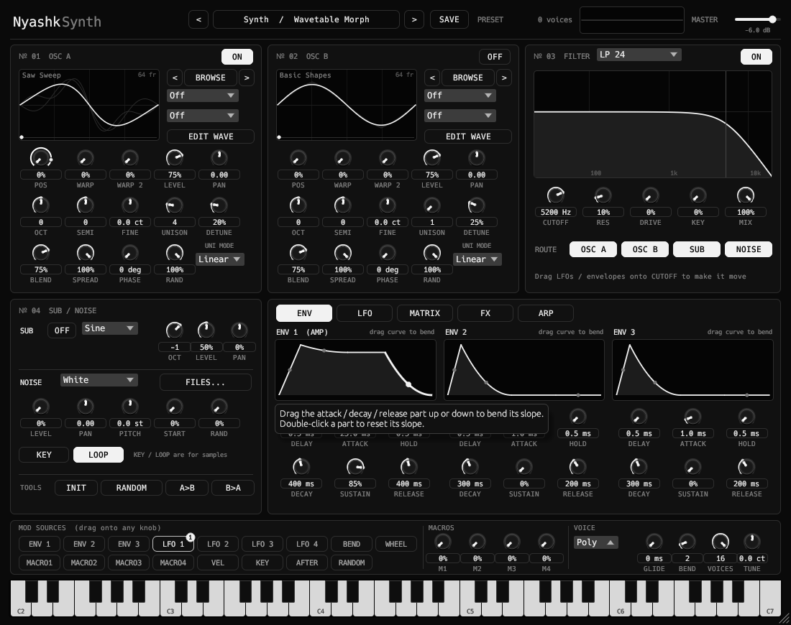
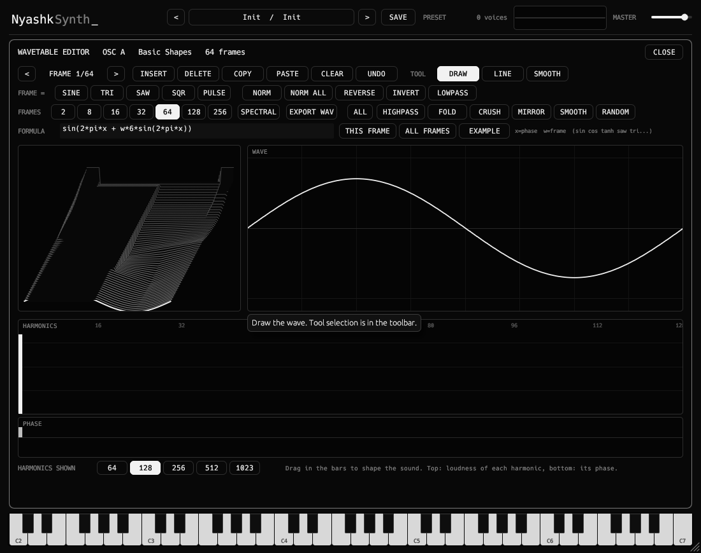
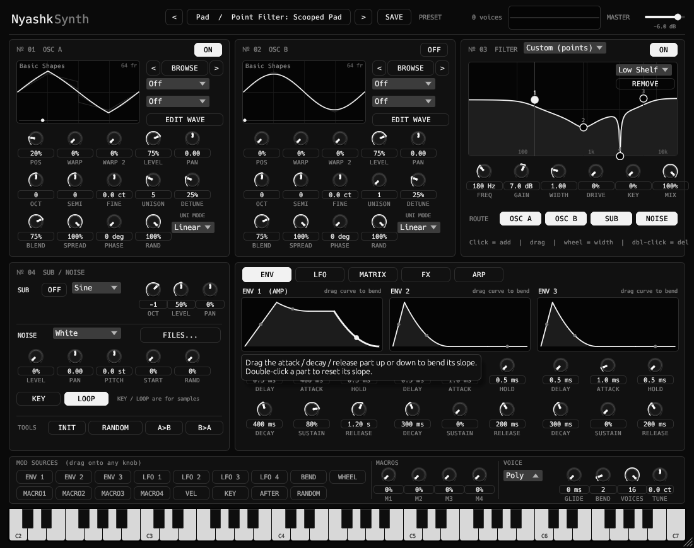

<div align="center">

# NyashkSynth

NyashkSynth is a Serum-style wavetable synthesizer VST3 plugin.

[](https://github.com/xslimakx/NyashkSynth/actions/workflows/build.yml)
[](LICENSE)


[**Download**](https://github.com/xslimakx/NyashkSynth/releases/latest)

</div>

---

## 🎹 NyashkSynth: wavetable synthesizer

A Serum-style wavetable synthesizer in the same black-and-white Nyashk design.

<p align="center"></p>
<p align="center"></p>

| | |
|---|---|
| **Oscillators** | 3 oscillators (A/B/C), each wavetable, **sample** (start / end / loop / ping-pong) or **granular** with a built-in table library, **warp ×2 per oscillator (22 modes)**, unison (up to 16 voices, 4 modes), sub oscillator and noise (with sample loading) |
| **Wavetable editor** | Draw, edit harmonics (amp/phase), formula generator (`sin(x*tau)*…`), spectral and time ops, **multi-frame editing** (select a range of frames and draw/process them together, with strength, fade, soft edges, vary and drift), frame morphing, undo/redo, import and export of `.wav` tables |
| **Filter** | **two filters** (series or parallel) with 16 classic types (LP/HP/Band/Notch, Ladder, shelves, combs, phaser, formant) plus **Custom (points)**: up to 8 draggable EQ-style points (bell, shelves, HP/LP, notch, band) placed right on the response graph; routing per source |
| **Envelopes / LFOs** | 4 envelopes with bendable slopes and invert-legato, 8 LFOs (12 shapes incl. Lorenz/Rössler chaos, drawable curve, delay, one-shot, tempo sync) |
| **Mod matrix** | 16 slots, drag any source onto any knob, per-slot curve / uni / aux source, live modulation dots on the knobs, **FX parameters are modulatable** |
| **Effects** | Hyper/Dimension, Distortion, Flanger, Phaser, Chorus, Delay, Compressor, Reverb, EQ, Filter, **Bode** frequency shifter, **Utility**: reorderable chain, **two FX buses** with series / parallel / low-high / low-mid-high / mid-side routing; Overdrive + DC bias, 4 reverb algorithms, Delay HQ |
| **Arpeggiator** | 7 patterns + **16-step Pattern editor**, 18 rates incl. triplets/dotted, gate, swing, octaves, hold |
| **Sequencing** | **Clip sequencer**: 12 clips with piano roll, transposed from the held key |
| **Browser** | categories, search, favorites, **star ratings and tags** |
| **Layout** | Serum-style pages: SOUND / MOD / MATRIX / FX / SEQ / SETTINGS |
| **Workflow** | Undo / redo (Ctrl+Z / Ctrl+Y), SETTINGS tab (A4 / scale tuning, MIDI channel, velocity curve) |
| **MIDI** | **MIDI learn** on every knob, OCT/SEMI transpose spinners, pitch and mod wheels |
| **Performance** | Poly / Mono / Legato, glide, sustain pedal, mod wheel, pitch bend, aftertouch, on-screen keyboard, oscilloscope |
| **Presets** | 68 factory presets in categories, user presets / tables / noises as plain files you can drop into folders. The RANDOM button builds a full new patch (matrix routes, all 4 LFOs, 3 envelopes, macros, FX, arp reset) |

📖 **[Illustrated manual with annotated screenshots](docs/MANUAL.md)**



**Drag and drop:** drop a `.wav` onto OSC A / OSC B to load it as a wavetable, onto the SUB/NOISE panel to use it as a noise sample, or drop a `.nyp` file anywhere to load a preset. Dropped files are also copied into your library folders (works on Linux/X11, Windows and macOS hosts that pass file drops to plugins).

User data: `~/.config/NyashkSynth/{Presets,Tables,Noises}` (Windows: `%APPDATA%\NyashkSynth\…`).

### Wavetable editor in short

- **Frame strip** (top): click a frame, drag to select a range, Shift+click to extend, ←/→ to walk through frames.
- **APPLY TO**: *Frame*, *Selection* or *All frames*. Every process button (NORM, REVERSE, LOWPASS, FOLD, SMOOTH, RANDOM, set-to-shape, formula GENERATE …) acts on the chosen frames.
- **STRENGTH / FADE / SOFT EDGES**: how much of the change each frame gets: flat, in, out, middle or edges, from hard to smooth borders.
- **Drawing on many frames**: with a range selected, what you draw in the WAVE view changes only that piece of the wave on every selected frame. **VARY** gives each frame a different amount, **DRIFT** slides the piece a bit further on each next frame.
- **MORPH** interpolates the frames inside the range between its first and last frame (spectral or linear).
- **SAVE TO LIBRARY** writes the wavetable as a Serum-compatible `.wav` into `Tables/My Waves`, where it shows up in the browser. Custom tables are also stored inside presets and projects.

**Rendering.** On Linux the UI is drawn through Vulkan (wgpu) and falls back to a fast CPU renderer automatically. Force the CPU path with `NYASHK_RENDER=cpu`; the chosen renderer is logged to `/tmp/nyashktune.log`. Windows uses OpenGL.

---

## Installation

Download the archive for your OS from [Releases](https://github.com/xslimakx/NyashkSynth/releases/latest), unzip it and copy `NyashkSynth.vst3` into your VST3 folder:

| OS | Path |
|---|---|
| Linux | `~/.vst3/` or `/usr/lib/vst3/` |
| Windows | `C:\Program Files\Common Files\VST3\` |
| macOS | `~/Library/Audio/Plug-Ins/VST3/` |

## Building from source

Needs [Rust](https://rustup.rs/) (stable). Linux: `libasound2-dev libgl-dev libx11-xcb-dev libxcb1-dev libxcb-icccm4-dev libxcursor-dev libxkbcommon-dev libxcb-dri2-0-dev`.

```bash
git clone https://github.com/xslimakx/NyashkSynth.git
cd NyashkSynth
cargo xtask bundle -p nyashksynth --release   # -> target/bundled/NyashkSynth.vst3
cargo run --release -p nyashksynth --features standalone   # standalone test app
```

## License

[MIT](LICENSE). Note: compiled `.vst3` builds link GPLv3 `vst3-sys` bindings (via NIH-plug), so GPLv3 terms apply when you distribute compiled binaries. Crates in `vendor/` keep their own licenses.

Part of the Nyashk plugins family: [NyashkTune](https://github.com/xslimakx/NyashkTune) · [NyashkOpto](https://github.com/xslimakx/NyashkOpto)
