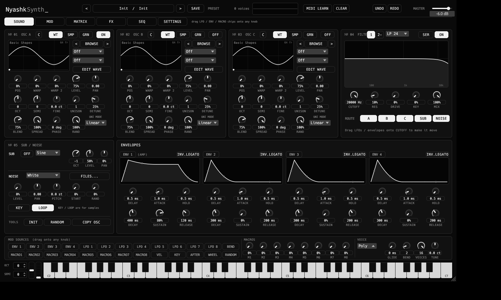
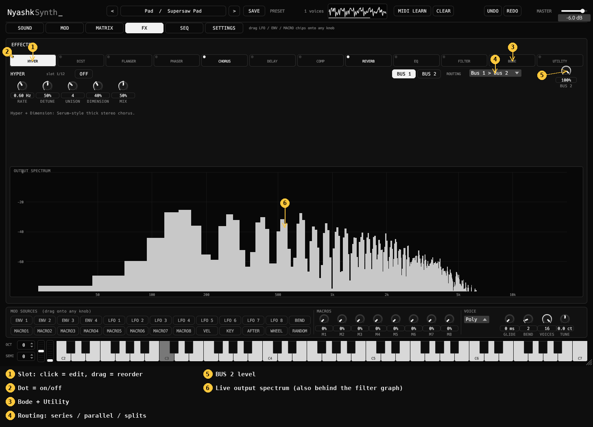
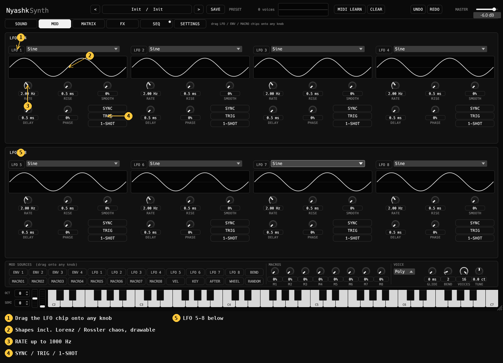
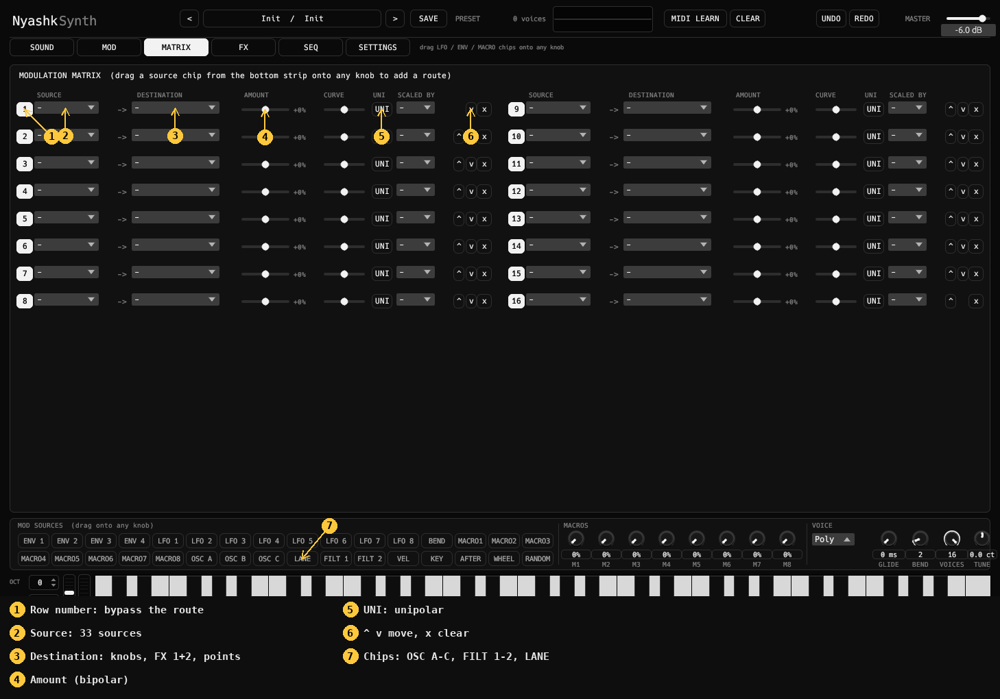
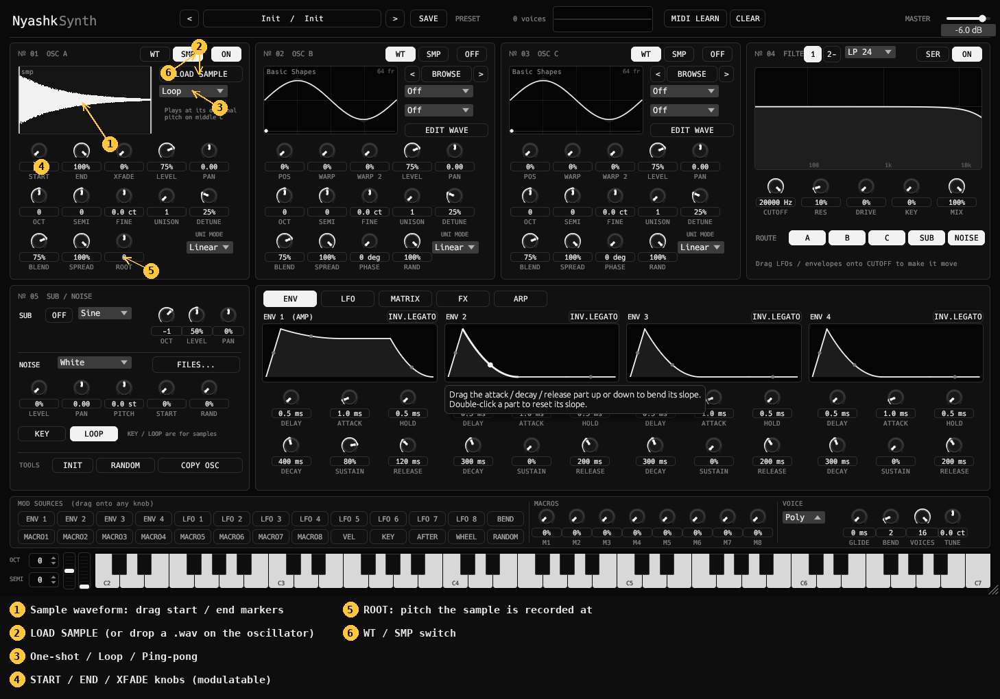
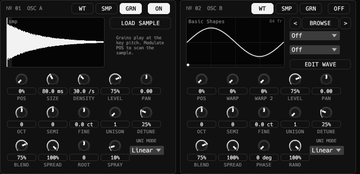
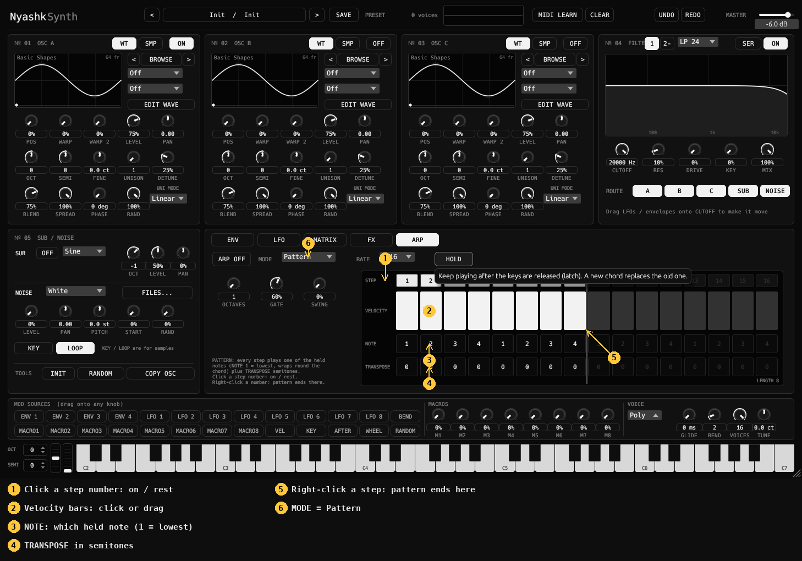
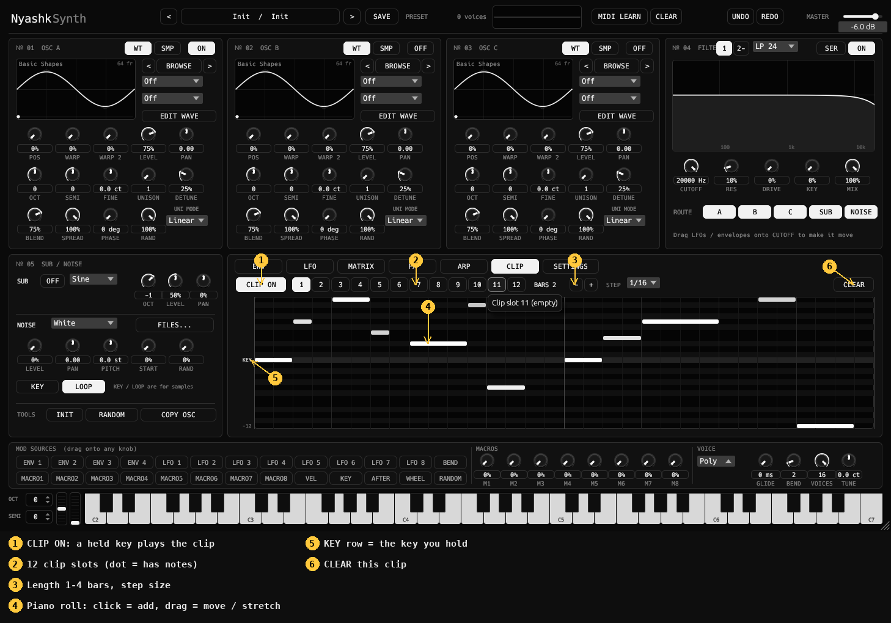
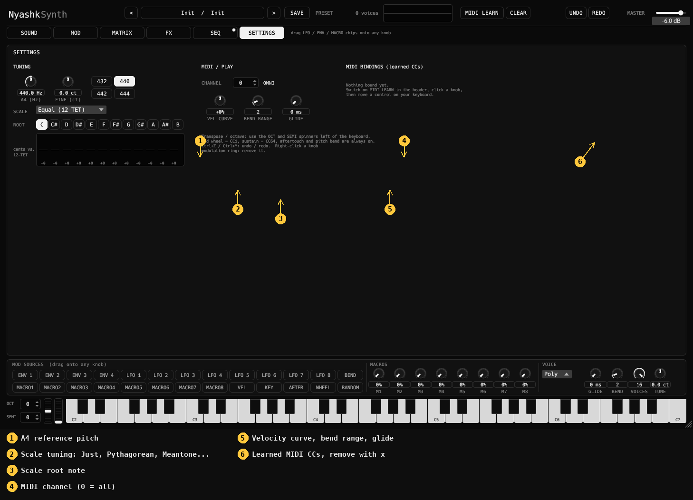
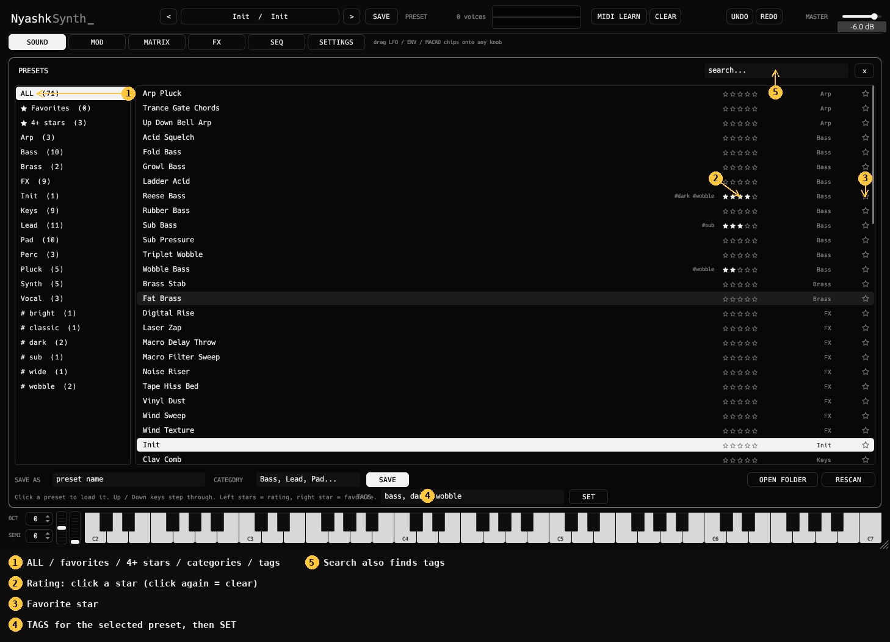

# NyashkSynth manual

Quick visual guide. Every numbered badge in a picture is explained under it.

## 0. Pages

Like Serum, the plugin is split into pages (buttons under the header):

| Page | What is on it |
|---|---|
| **SOUND** | 3 oscillators, 2 filters, sub / noise, 4 envelopes |
| **MOD** | all 8 LFOs at once |
| **MATRIX** | all 16 modulation routes in two columns |
| **FX** | effects chain, two buses, routing |
| **SEQ** | arpeggiator (with pattern editor) and clip sequencer |
| **SETTINGS** | tuning, MIDI, learned CCs |

The mod-source chips, macros, voice settings, keyboard and wheels stay visible on every page.

## 1. Overview

1. **Oscillators A / B / C**: each has a wavetable view, BROWSE, two warp slots, POS, WARP, WARP 2, LEVEL, PAN, OCT, SEMI, FINE, UNISON, DETUNE, BLEND, SPREAD, PHASE, RAND. `EDIT WAVE` opens the wavetable editor. COPY OSC (bottom left) copies an oscillator to another.
2. **Filter**: two filters (tabs **1** and **2**), `SER` toggles series / parallel. 16 types plus **Custom (points)**: drag up to 8 EQ-style points on the graph. `ROUTE` picks which sources feed the selected filter.
3. **MIDI LEARN**: switch it on, click any knob, then move a knob/fader on your MIDI keyboard. The knob shows `CCn`. Right-click a bound knob to unbind, `CLEAR` removes all bindings. Bindings are saved with the project.
4. **SUB / NOISE** with INIT, RANDOM and COPY OSC tools.
5. **Pages**: SOUND, MOD (8 LFOs), MATRIX (16 slots), FX, SEQ (arp + clips), SETTINGS.
6. **Mod sources**: drag a chip onto any knob; drag vertically on the knob to set the depth. Right-click the modulation ring to remove it.
7. **8 macros**: assign them like any other source.
8. **OCT / SEMI spinners and wheels**: click the arrows, drag, use the mouse wheel; double-click resets. They transpose both MIDI input and the on-screen keys. The pitch wheel springs back, the mod wheel stays where you leave it; both follow your hardware wheels.
9. **Master**: drag, or double-click and type a dB value.
10. **Presets**: browse, SAVE; the delete button also removes empty category folders.

## 2. Effects

1. **Chain slot**: click to edit, drag onto another slot to reorder.
2. **Dot** = on/off.
3. **Bode** (frequency shifter) and **Utility** (gain, pan, width, mono, invert).
4. **Routing**: Bus 1 > Bus 2 (series), parallel, split low/high, split mid/side. Buses 1 and 2 hold the same effects, so you can use an effect twice.
5. **BUS 2** sets the level of the second bus.

## 3. LFOs

1. Switch between LFO 1-4 and LFO 5-8.
2. Shapes include **Lorenz** and **Rössler** chaos, drawable curve, random and more.
3. SYNC (tempo), TRIG (restart on note), 1-SHOT.
4. Rate goes up to 1000 Hz; RISE, SMOOTH, DELAY and PHASE shape the output.

## 4. Playing with a MIDI keyboard

* Notes, velocity, pitch bend, mod wheel, aftertouch and sustain pedal are handled.
* OCT / SEMI shift incoming notes; notes already held are released correctly when you change the shift.
* MIDI learn works for every parameter: oscillator, filter, envelope, LFO, FX and macro knobs.

## 3b. Modulation matrix

Each route: **source**, **destination**, **amount** (bipolar), **curve**, **UNI** (unipolar) and an optional **scaled by** source. Routes made by dragging a chip onto a knob appear here automatically.

## 4b. Sample oscillator

Each oscillator can be switched between **WT** (wavetable) and **SMP** (sample) with the two buttons next to ON.

1. Drag the start / end markers on the waveform, or use the **START / END** knobs (both can be modulated, so you can scan through a sample).
2. **LOAD SAMPLE** opens the sample browser (your `Noises` folder); you can also drop a `.wav` on the oscillator. The first 4 seconds are used.
3. **One-shot / Loop / Ping-pong**; **XFADE** crossfades the loop seam.
4. **ROOT** shifts the pitch the sample was recorded at. A sample plays at its original speed on middle C, follows the keyboard, OCT / SEMI / FINE and unison.
5. Sample oscillators go through the same filters, envelopes and FX as wavetable ones.

## 4b2. Granular oscillator

Press **GRN** next to ON. The oscillator plays a cloud of short grains read from a loaded sample.

* **POS** where in the sample the grains start; modulate it with an LFO or envelope to scan through the sample. The marker on the waveform shows it (drag it), the shaded band is the **SPRAY** range.
* **SIZE** grain length (5-500 ms), **DENSITY** grains per second (up to 256), **SPRAY** random spread of the grain positions.
* Grains play at the key pitch (ROOT shifts it). Overall level is kept steady when you raise density.

## 4c. Arpeggiator pattern editor

Set **MODE = Pattern** in the ARPEGGIATOR panel of the SEQ page. 16 steps, each with on / rest, velocity, which held note it plays (1 = lowest, wraps round the chord) and a transposition in semitones. Right-click a step number to end the pattern there. The pattern is saved with presets and projects.

## 4d. Clip sequencer

Open the **SEQ** page, go to the CLIP SEQUENCER panel and switch **CLIP ON**. Hold a key: the selected clip plays and loops, transposed from the key you hold (the **KEY** row of the piano roll is that key). Releasing the key stops it.

1. **CLIP ON** replaces the arpeggiator while it is on.
2. **12 clip slots**; a dot marks slots that contain notes. Clips are saved with the preset.
3. **BARS** (1-4) and **STEP** (grid size, 1/16 by default).
4. Piano roll: click = add a note, drag right = longer, drag a note = move it (also up / down), right-click = delete, mouse wheel over a note = velocity (brighter = louder).
5. Range is one octave below to 11 semitones above the held key.

## 4e. Settings tab

1. **A4 reference** from 400 to 480 Hz with quick buttons for 432 / 440 / 442 / 444, and a fine tune in cents.
2. **Scale tuning**: Equal, Just intonation, Pythagorean, Meantone 1/4, Werckmeister III, with a **root** note. The bars show the deviation from equal temperament in cents.
3. **MIDI channel** (0 = omni), **velocity curve**, **pitch-bend range**, glide.
4. **MIDI bindings**: every learned CC with its parameter name and an x to remove it.

LFOs and envelopes can be dragged onto any knob straight from their title chips in the LFO / ENV tabs, like in Serum.

## 4f. Spectrum analyser

The FX page shows a live output spectrum (20 Hz - 20 kHz, log scale). A dim copy of the same spectrum also runs behind the filter graph, so you can see what you are cutting.

## 4g. Preset browser: stars and tags

Click the stars on the left of a row to rate a preset (click the same star again to clear it). Select a preset, type comma separated tags in the TAGS box and press SET. The list on the left gets a "4+ stars" entry and one entry per tag; the search box also matches tags. Ratings and tags live in `meta.txt` next to your presets, so they are not lost when presets are re-installed.

## 4h. Undo / redo

UNDO and REDO (header, or Ctrl+Z / Ctrl+Y) step through your parameter changes, including preset loads. Wavetable-editor edits have their own undo inside the editor.

## 5. Feature status compared to Serum 2

| Area | Status |
|---|---|
| 3 wavetable oscillators, dual warp, unison, sub, noise | done |
| 2 filters, series/parallel, custom point filter | done |
| 8 LFOs (with Lorenz/Rössler), 4 envelopes (invert legato), 8 macros | done |
| 2 FX buses, Bode, Utility, split routing | done |
| MIDI learn, transpose, wheels | done |
| Sample oscillator (start / end / loop / ping-pong / crossfade) | done |
| Arp pattern editor, undo / redo | done |
| Granular oscillator, spectrum analyser, preset stars and tags | done |
| Multisample (SFZ) / Spectral oscillator modes | not yet |
| Clip sequencer (12 clips, piano roll) | done |
| Serum-style pages (SOUND / MOD / MATRIX / FX / SEQ / SETTINGS) | done |
| Tuning (A4, scales), MIDI channel, velocity curve | done |
| Arp banks (12 slots), oscillator mapping editor | not yet |
| Convolve, reverb types, preset tags and ratings | not yet |
